# Quick Start Guide

---

## Table Of Contents

- [Installation](#install)
- [Documentation](#docs)
- [Basic Overview](#overview)
- [The Sequencer](#sequencer)
    - [A Sequence](#seq-seq)
        - [Tempo Command](#seq-tempo)
        - [Meter Command](#seq-meter)
        - [SetPatch Command](#seq-setpatch)
        - [Note Command](#seq-note)
    - [Chords, Arpeggios and Scales](#seq-scale)
        - [Chords](#seq-chord)
        - [Arpeggios](#seq-arp)
        - [Inversions](#seq-inv)
    - [Building Larger Sequences](#seq-build)
    - [Chopping Up a Sequence](#seq-chop)
- [Creating a Patch](#create)
    - [A Basic Patch](#cre-basic)
    - [Adding a Transient](#cre-attack)
    - [A More Advanced Patch](#cre-advance)
    - [Shaping With Envelopes](#cre-env)
        - [Envelope Easing](#cre-env2)
- [The Sound Object](#snd)
    - [Creating a Sound Effect](#snd-create)
    - [Getting More Musical](#snd-music)
    - [Layered vs Sequential Sounds](#snd-layer)
- [Tones - The Building Blocks](#tones)
    - [A Note on Waves](#ton-wave)
    - [Defining a Custom Wave](#ton-custom)
- [Effects](#effects)
    - [Tone effects](#fx-tone)
    - [DSP effects](#fx-dsp)
    - [Note effects](#fx-note)
- [Easing Functions](#easing)
    - [Custom Easing Functions](#eas-custom)
- [Playback](#playback)
    - [ChirpPlayer and Chirper](#play-chirp)
        - [Play](#play-play)
        - [PlaySolo](#play-solo)
        - [PlayQueued](#play-queued)
        - [StopAll](#play-stopall)
        - [SetVolume](#play-vol)
        - [GetStats](#play-stats)
    - [Voice Handle](#play-handle)
- [Saving and Loading Sounds](#saveload)
    - [Saving Sounds](#sl-save)
    - [Loading Sounds](#sl-load)
- [Constants](#constants)
    - [Note Frequency](#con-freq)
    - [Note Length](#con-len)
    - [Note/Tone Dynamics](#con-dyn)
    - [Vibrato Strength](#con-vib)
    - [Tremolo Strength](#con-trem)
    - [Filter QFactor](#con-q)
    - [Frequency Ratios](#con-ratio)
    - [Scales and Chords](#con-scale)

---

<a id="install"></a>

## Installation

Chirper requires numpy and Python 3.10 or newer.

From the Chirper project root:

```powershell
python -m pip install -e .
```

For faster rendering, install numba as well:

```powershell
python -m pip install -e ".[performance]"
```

If you are working from source without installing, run scripts from the Chirper project root or add it to `PYTHONPATH`.

---

<a id="docs"></a>

## Documentation

- [Quick Start Guide](QUICKSTART.md) provides a tutorial for getting up and running.
- [API reference](API_REFERENCE.md) provides a comprehensive guide to the Chirper API.

<a id="overview"></a>

---

## Basic Overview

Chirper has a simple workflow:

- At the base level are `Tone` objects, which describe oscillator events. `Tone` objects are the objects that actually generate sound.
- Groups of `Tone` objects and other effects can be compiled into a `Patch`, which describes a recipe for generating a sound from a `Note`.
- A `Note` then describes a musical note with all its articulations. A `Note` is sent through a `Patch`, which asks the `Tone` objects in its recipe to generate sound based on the parameters provided by the `Note`.
- A group of `Note` objects can be assembled into a `Sequence`.
- Once a `Sequence` is assembled, it can be rendered into actual sound data by using it to contruct a `Sound` object.
- The `Sound` object can then be played back using the built-in player, or exported as a `.chirp` or `.wav` file.

Besides sequences, notes and patches, `Sound` objects can also be contructed directly from `Tone` objects.

<a id="sequencer"></a>

---

## The Sequencer

The sequencer is the quickest way to lay down some music. Just enter a tempo, set a time signature, select a patch and start placing down notes.

<a id="seq-seq"></a>

### A Sequence

#### `Sequence(events = None)`

A `Sequence` is a list of `Note` and control commands. Construct a `Sound` with a `Sequence` to render the sequence.

Example:

```python
from Chirper import *

pattern = Sound(
    Sequence([
        # Control commands:
        Tempo(120),
        Meter(4, 4),
        SetPatch(Patches.SuperSine),

        # Note Commands:
        # Bar, Beat, Note, Duration, Amplitude
        # Articulation effects can be chained onto Notes

        # Bar 1:
        Note(0, 0.0, N.C4, L.L4, D.D00).Vibrato().Fade(D.D11),
        Note(0, 1.0, N.G4, L.L8, D.D10),
        Note(0, 2.0, N.E4, L.L4, D.D11),
        Note(0, 3.0, N.G4, L.L8, D.D12),

        # Bar 2:
        Note(1, 0.0, N.B3, L.L4, D.D11),
        Note(1, 0.5, N.B3, L.L4, D.D09),
        Note(1, 1.0, N.G4, L.L8, D.D10),
        Note(1, 2.0, N.D4, L.L4, D.D11).Vibrato(V.LIGHT),
        Note(1, 3.0, N.G4, L.L8, D.D12),

        # Bar 3:
        Note(2, 0, N.C4, L.L4, D.D13).Vibrato().Fade(D.D00, "outsine"),
    ])
# Additional DSP effects can be chained onto the Sound
).SoftClip().Chorus().MTVerb().Normalize(3.0)
```

Once the sequence has been constructed into a `Sound`, it can be played back with `Chirper`:

```python
chirper = Chirper()

handle = chirper.Play(pattern, blocking = True)

chirper.Close()
```

The commands `Tempo`, `Meter` and `SetPatch` default to `120`, `4, 4` and `SuperSine` if not set. `SetPatch` can be called again at any point to change the `Patch` being used by the `Sequence`.

<a id="seq-tempo"></a>

#### Tempo Command

#### `Tempo(bpm)`

The `Tempo` command sets the tempo for `Note` duration calculations. `Note` durations are fractions of one whole note.

Only one `Tempo` command may be set per `Sequence`. To change tempo, use `Sequence` concatenation. See [Building Larger Sequences](#seq-build).

<a id="seq-meter"></a>

#### Meter Command

#### `Meter(beats, unit)`

The `Meter` command sets the time signature used to resolve note timings. `Meter(4, 4)` is four quarter-note beats per bar. `Meter(6, 8)` is six eighth-note beats per bar.

Only one `Meter` command may be set per `Sequence`. To change meter, use `Sequence` concatenation. See [Building Larger Sequences](#seq-build).

<a id="seq-setpatch"></a>

#### SetPatch Command

#### `SetPatch(patch, balance = 0.0, polyphonic = None, portamento = None)`

|Parameter|Description|
|---:|:---|
|`patch`|A `Patch` object.|
|`balance`|Controls the balance between the transient layer and the body layer. `-1.0` means only transient, and `+1.0` is only body. Not all patches may implement attack transients or harmonic bodies.|
|`polyphonic`|Controls whether the patch allows simultaneous notes to be played. If set to `False` (the patch is monophonic), oscillator states will not reset between compatible notes (compatibility depends on waveform/layer structure, modulation settings, pan, and matching gain at old note end and new note start). If set to `None`, the `Patch` default setting is used.|
|`portamento`|When `polyphonic` is `False`, overlapping notes will glide to the new note's pitch. Ignored if `polyphonic` is `True`.<br>`None` will use the `Patch` default, `True` or `False` will explicitly enable or disable the effect.|

The `SetPatch` command selects the patch that notes are routed through for rendering.

<a id="seq-note"></a>

#### Note Command

#### `Note(bar, beat, freq, duration, amplitude = 1.0)`

|Parameter|Description|
|---:|:---|
|`bar`|Which bar the note belongs to. First bar is bar 0.|
|`beat`|Which beat in the bar the note belongs to. First beat is beat 0. Beats placed outside a bar are discarded.|
|`freq`|Frequency in hertz. Use the constant class `NoteFrequency` (`N` for short) for easy input.|
|`duration`|Fraction of one whole note.|
|`amplitude`|Linear gain passed into the Patch recipe.|

Note commands describe notes and supply the `Patch` object with parameters for note rendering.

The [`NoteFrequency`](#con-freq) class (`N` for short) contains equal-tempered note frequencies from `C1` through `B9`. Sharps use `S` in the name, such as `N.FS4`; equivalent flats are also available, such as `N.GB4`. `N.MIN` and `N.MAX` represent 20Hz and 20kHz respectively.

`duration` is a fraction of one whole note, with 1.0 meaning 1 whole note, and 0.5 meaning half a whole note. The [`NoteLength`](#con-len) class (`L` for short) contains hard-coded fractions, with `L.L4` meaning 1 quarter note, `L.L8` meaning one eighth note and so on.

`amplitude` is linear gain. The [`Dynamics`](#con-dyn) class (`D` for short) contains perceptually spaced linear gain values from `D.D00` (0.0) through `D.D15` (1.0), spaced approximately 3dB apart.

Additional articulation commands like `Vibrato`, `Tremolo` and `Fade` can be chained onto `Note` objects.

<a id="seq-scale"></a>

### Chords, Arpeggios and Scales

There are a few helper functions that can be chained onto `Note` objects to help write accompaniment. These take in a list of absolute frequencies or frequency ratios. When ratios are supplied, they are applied to the base frequency defined in the `Note`.

Chirper differentiates ratios from absolute frequencies by one simple rule: If the supplied value is less than 20.0, Chirper assumes it is a ratio. If it is above or equal to 20.0, Chirper assumes it is an absolute frequency.

Supply only frequency ratios or absolute frequencies, Chirper will reject mixed lists. The original `Note` frequency is added by default and is not required to be included in the list. `Chord` and `Arpeggio` are mutually exclusive - the last called `Chord` or `Arpeggio` on a `Note` overwrites all previous calls.

The classes [`JustRatio`](#con-ratio), [`EqualRatio`](#con-ratio), [`JustScale`](#con-scale) and [`EqualScale`](#con-scale) contain useful constants for harmonic intervals, musical scales and many different chords.

<a id="seq-chord"></a>

#### Chords

#### `Chord(pattern, roll = 0.0, dynamics = None, inversion = 0)`

|Parameter|Description|
|---:|:---|
|`pattern`|List of frequency ratios or absolute frequencies forming the additional chord voices.|
|`roll`|Signed whole-note fraction controlling the delay between adjacent pitches. `Sequence` tempo resolves it to seconds.|
|`dynamics`|Optional nonempty list of gain multipliers shaping the chord from its lowest pitch to its highest pitch.|
|`inversion`|Signed integer controlling how many times the chord voices are rotated. `None` is treated as `0`.|

`Chord` lets you supply a list of frequencies or frequency ratios that play simultaneously with the `Note` frequency.

When `roll` is not zero, each successive chord tone will play out with a slight delay, like a guitar strum. Positive values roll from the bass frequency up, and negative values roll from the highest frequency down. `roll` is the delay time in fractions of a whole note.

The `dynamics` argument is a list of gain keyframes for the chord sequence. This value is additional gain on top of the `Note` amplitude. Each chord tone has an amplitude that is the `Note` amplitude multiplied by a geometrically interpolated gain value from the supplied list. Setting `dynamics` to `None` uses only the base `Note` amplitude.

```python
from Chirper import *

pattern = Sound(
    Sequence([
        Tempo(120),
        Meter(4, 4),
        SetPatch(Patches.SuperSine),

        # Single C note:
        Note(0, 0.0, N.C5, L.L4D, D.D08),


        # Instant chords and their spellings:

        # The following chords all produce the same sound and
        # are just different ways of spelling the same thing.

        # C Minor 7th chord made using a ratio list from the EqualScale class:
        Note(0, 2.0, N.C5, L.L4D, D.D08).Chord(ES.MIN7),

        # C Minor 7th chord made using absolute frequencies from the Note class:
        Note(1, 0.0, N.C5, L.L4D, D.D08).Chord([N.EB5, N.G5, N.BB5]),

        # C Minor 7th chord made using ratios from the EqualRatio class:
        Note(1, 2.0, N.C5, L.L4D, D.D08).Chord([ER.MIN3, ER.FIFTH, ER.MIN7]),

        # C Minor 7th chord made using ratios:
        Note(2, 0.0, N.C5, L.L4D, D.D08).Chord([1.189, 1.498, 1.782]),

        # C Minor 7th chord made using absolute frequencies:
        Note(2, 2.0, 523.25, L.L4D, D.D08).Chord([622.25, 783.99, 932.33]),


        # Roll:

        # C Minor 7th chord that rolls up from C to Eb to G to Bb,
        # with a delay of a 32nd note between each tone:
        Note(3, 0.0, N.C5, L.L4D, D.D08).Chord(ES.MIN7, roll = L.L32),

        # C Minor 7th chord that rolls down from Bb to G to Eb to C,
        # with a delay of a 32nd note between each tone:
        Note(3, 2.0, N.C5, L.L4D, D.D08).Chord(ES.MIN7, roll = -L.L32),


        # Dynamics:

        # C Minor 7th chord with all notes playing at D08:
        Note(4, 0.0, N.C5, L.L4D, D.D08).Chord(ES.MIN7, dynamics = [1.0]),
        Note(4, 2.0, N.C5, L.L4D, D.D08).Chord(ES.MIN7, dynamics = None),
        Note(5, 0.0, N.C5, L.L4D, D.D08).Chord(ES.MIN7),

        # C Minor 7th chord with a smooth ramp from half volume to full volume across the chord:
        Note(5, 2.0, N.C5, L.L4D, D.D08).Chord(ES.MIN7, dynamics = [0.5, 1.0]),

        # C Minor 7th chord with an amplitude multiplier for each note:
        # C plays at  D.D08 * 0.707,
        # Eb plays at D.D08 * 0.250,
        # G plays at  D.D08 * 0.500,
        # Bb plays at D.D08
        Note(6, 0.0, N.C5, L.L4D, D.D08).Chord(ES.MIN7, dynamics = [0.707, 0.25, 0.5, 1.0]),
    ])
)
```

> #### **_Note:_** You do not have to supply the base/root/fundamental in the list, it will be added by default if it's missing. Duplicate entries will also be removed.

<a id="seq-arp"></a>

#### Arpeggios

#### `Arpeggio(pattern, step = L.L16, dynamics = None, rotation = 0)`

|Parameter|Description|
|---:|:---|
|`pattern`|List of frequency ratios or absolute frequencies.|
|`step`|Whole-note fraction determining the duration of each generated Note. `Sequence` tempo resolves it to seconds.|
|`dynamics`|Optional nonempty list of gain multipliers shaping one complete arpeggio cycle.|
|`rotation`|Signed integer controlling how many times the pattern is rotated. `None` is treated as `0`.|

`Arpeggio` lets you supply a list of frequencies or frequency ratios to play consecutively over the note's duration. `step` controls how long each note in the arpeggio lasts.

`pattern` and `dynamics` behave mostly the same as they do in [`Chord`](#seq-chord). The difference is that while duplicate frequencies and ratios are removed in `Chord`, they are retained in an `Arpeggio` list.

The same ratio and absolute-frequency list construction rules apply to both `Arpeggio` and `Chord`.

```python
from Chirper import *

pattern = Sound(
    Sequence([
        Tempo(120),
        Meter(4, 4),
        SetPatch(Patches.SuperSine),

        # Single C note:
        Note(0, 0.0, N.C5, L.L1, D.D08),

        # Play each note of a C minor major 7th chord at 8th note intervals
        # for the duration of two whole notes (2 bars at 4/4):
        Note(1, 0.0, N.C5, L.L2X, D.D08).Arpeggio(ES.MINMAJ7, L.L8),
    ])
)
```

The arpeggio pattern loops when the `Note` lasts longer than one complete cycle at the specified `step` length.

Other `Note` effects like `Bend`, `StepBend` and `Trill` also accept frequency ratios as well as absolute frequencies.

<a id="seq-inv"></a>

#### Inversions

`Chord` and `Arpeggio` lists can be inverted. In this context, inversion refers to moving the first entry in the list (usually the root note) to the end of the list. If used with `Chord`, the swapped item is shifted by an octave.

When applied to a simple major triad, `inversion = 1` returns a list ordered third, fifth, root. `inversion = 2` returns fifth, root, third. At this point we've been through all permutations, so adding any more to `inversion` will just return an octave shifted copy of a prior inversion when used with `Chord`, or a just a prior inversion if used with `Arpeggio`.

For example, with `Arpeggio`, if we used `inversion = 3` on a major triad, we would just get the exact same major triad back. If used with `Chord`, that triad would be one octave higher. Setting `inversion = 4` would return a first inversion chord (third, fifth, root), but one octave higher, and so on.

`inversion` can also be negative, in which case the last note is popped off the list and inserted at the beginning.

<a id="seq-build"></a>

### Building Larger Sequences

Songs in the real world are often built up from several repeating phrases and elements. Manually writing out a four on the floor drum sequence for an entire song would be incredibly tedious, so to aid in building out larger sequences and more complex songs, sequences can be multiplied to repeat them and then concatenated together.

Example:

```python
from Chirper import *

verse = Sequence([
    Tempo(120),
    Meter(4, 4),
    SetPatch(Patches.SuperSine),

    Note(0, 0.0, N.C4, L.L4, D.D11),
    Note(0, 1.0, N.G4, L.L8, D.D10),
    Note(0, 2.0, N.E4, L.L4, D.D11),
    Note(0, 3.0, N.G4, L.L8, D.D12),
])

chorus = Sequence([
    Tempo(60),
    Meter(4, 4),
    SetPatch(Patches.SuperSaw),

    Note(0, 0.0, N.C4, L.L4, D.D12),
    Note(0, 1.0, N.C4, L.L8, D.D11),
    Note(0, 2.0, N.C4, L.L4, D.D10),
    Note(0, 3.0, N.G4, L.L8, D.D12),
])

# Create a sequence with two verses,
# followed by one chorus,
# and then two more verses, each one 3db softer than the previous
fullSequence = (verse * 2) + chorus + (verse.Gain(0.7071) + verse.Gain(0.5))

# Render the song with some reverb
renderedSong = Sound(fullSequence).MTVerb()

# Play back the rendered Sound
chirper = Chirper()

chirper.Play(renderedSong, blocking = True)

chirper.Close()
```

`Gain(amount)` chained to the end of a `Sequence` returns a new `Sequence` with all `Note` and `Fade` amplitudes scaled by `amount`.

> #### **_Note:_** While a single `Sequence` accepts at most one `Tempo` and one `Meter` command when constructed, each `Sequence` retains its own `Tempo` and `Meter` commands when they are concatenated together. This means that in order to construct songs that change tempo or meter, you will need to construct multiple `Sequence` objects and concatenate them.

<a id="seq-chop"></a>

### Chopping Up a Sequence

Larger sequences can also be chopped up and rearranged, using the `Start` and `End` functions. `Start` is inclusive and `End` is exclusive, so `sequence.Start(4, 2).End(8, 1)` includes bar index `4`, beat index `2`, but does not include bar index `8`, beat index `1`.

Notes placed within the bounds of the cut but having durations longer than the end of the cut will retain their full durations and tails.

```python
from Chirper import *

fullSequence = Sequence([
    Tempo(120),
    Meter(4, 4),
    SetPatch(Patches.SuperSine),

    # Bar 1
    Note(0, 0.0, N.C4, L.L4, D.D11),
    Note(0, 2.0, N.G4, L.L8, D.D10),

    # Bar 2
    Note(1, 0.0, N.E4, L.L4, D.D11),
    Note(1, 2.0, N.G4, L.L8, D.D12),

    # Bar 3
    Note(2, 0.0, N.B3, L.L4, D.D12),
    Note(2, 2.0, N.G4, L.L8, D.D11),

    # Bar 4
    Note(3, 0.0, N.D4, L.L4, D.D10),
    Note(3, 2.0, N.G4, L.L8, D.D12),
])

# start with the second bar,
# add on the first bar,
# and then finish off with the last two bars
# final sequence: Bar 2, 1, 3, 4 (index 1, 0, 2, 3)
rearrangedSeq = (
      fullSequence.Start(1, 0).End(2, 0)
    + fullSequence.Start(0, 0).End(1, 0)
    + fullSequence.Start(2, 0)
)

# Render the song with some reverb
renderedSong = Sound(rearrangedSeq).MTVerb()

# Play back the rendered Sound
chirper = Chirper()

chirper.Play(renderedSong, blocking = True)

chirper.Close()
```

Other helpers for `Sequence` exist, like `FirstBar` which returns the zero-indexed first bar of the sequence that contains a `Note`, empty bars are ignored. `LastBar` works in the opposite direction, and returns the last bar of the `Sequence` that contains a note-on event (tails and notes that extend into following bars do not mark that bar as occupied).

`Trim` returns a new `Sequence` with all leading and trailing empty bars stripped. The bars are re-indexed to `0`, so the first occupied bar becomes bar zero.

```python
from Chirper import *

# This Sequence contains Notes up to bar index 12,
# however the Notes only start at bar index 8
fullSequence = Sequence([
    Tempo(120),
    Meter(4, 4),
    SetPatch(Patches.SuperSine),

    # First occupied bar is at bar index 8
    Note(8, 0.0, N.C4, L.L4, D.D11),
    Note(8, 2.0, N.G4, L.L8, D.D10),

    # Last occupied bar is at bar index 8
    Note(12, 0.0, N.E4, L.L4, D.D11),
    Note(12, 2.0, N.G4, L.L8, D.D12),
])

# Return a new Sequence with leading blank bars trimmed:
# Bar index 0 in the new Sequence is bar index 8 in the old Sequence
rearrangedSeq1 = (fullSequence.Start(fullSequence.FirstBar(), 0))

# Return a new Sequence with all leading and trailing blank bars trimmed:
# Bar index 0 in the new Sequence is bar index 8 in the old Sequence
rearrangedSeq2 = fullSequence.Trim()
```

---

<a id="create"></a>

## Creating a Patch

#### `Patch(transient = None, body = None, transientGain = 1.0, bodyGain = 1.0, envelope = None, polyphonic = True, portamento = False)`

|Parameter|Description|
|---:|:---|
|`transient`|Callable function receiving `(freq, dur, amp)`, or `None`.|
|`body`|Callable function receiving `(freq, dur, amp)`, or `None`.|
|`transientGain`|Designer-defined gain for the attack transient layer.|
|`bodyGain`|Designer-defined gain for the harmonic body layer.|
|`envelope`|An amplitude `Envelope` applied only to the rendered body layer, or `None`.|
|`polyphonic`|When `True`, `Note` objects may overlap. When `False`, each new `Note` ends the inherited duration of the previous `Note` using this `Patch`. This is just the default setting for the `Patch`, users can still override it per `Sequence` when the `Patch` is selected|
|`portamento`|When `True`, portamento is enabled on this `Patch` by default. Ignored if `polyphonic` is `True`. Users can still override this per `Sequence`.|

Chirper ships with a few built-in patches, but you'll probably find yourself wanting more.

Patches are made up of two layers - a transient layer and a body layer. Each layer is constructed from a series of `Tone` objects. `Tone` objects describe oscillator functions and are responsible for generating the actual sounds in a patch.

Aside from `Tone` objects, other `Sound` objects may be inserted into Patch recipes as well, using `Insert(sound)`.

<a id="cre-basic"></a>

### A Basic Patch

This is a basic patch with no attack transient:

```python
from Chirper import *

def _SuperSawSustain(freq, dur, amp):
    return [
        Tone(freq      , dur, amp).Wave("SawAA").Unison(),
        Tone(freq * 0.5, dur, amp).Wave("TriangleAA").Unison(),
    ]

class MyPatches:
    SuperSaw = Patch(transient = None, body = _SuperSawSustain)
```

The above `Patch` is a recipe that combines two oscillators every time it receives a `Note` object. It generates an anti-aliased Saw wave at the requested frequency, duration and amplitude. It also generates an additional anti-aliased Triangle wave an octave lower.

Both waves have a `Unison` effect applied to them. These two tones are then mixed together and returned when the `Sequence` is constructed. This basic `Patch` has no attack transient.

<a id="cre-attack"></a>

### Adding a Transient

Let's spice up the `Patch` a bit and add a snappy pop to the sound.

```python
from Chirper import *

def _PluckyAttack(freq, dur, amp):
    return [
        Tone(freq, 0.2, amp).Wave("Sine").Bend(freq * 2.0, "inoutback").Fade(0.0, "outexpo"),
        Tone(freq, 0.2, amp).Wave("Sine").Bend(freq * 0.5, "inoutback").Fade(0.0, "outexpo"),
    ]

def _SuperSawSustain(freq, dur, amp):
    return [
        Tone(freq      , dur, amp).Wave("SawAA").Unison(),
        Tone(freq * 0.5, dur, amp).Wave("TriangleAA").Unison(),
    ]

class MyPatches:
    SuperSaw = Patch(transient = _PluckyAttack, body = _SuperSawSustain)
```

The above code adds a transient to our `Patch` that plays when the `Note` starts. It bends the note's frequency up one octave and down one octave via two simultaneous Sine waves, and then fades out.

If you look closer, you'll see that the `dur` value for the transient's tones is set explicitly - this means it will always play for the same amount of time regardless of note duration. `freq` and `amp` can also be set explicitly and do not have to use the value provided by the function arguments.

Patch recipes must always use the signature `FunctionName(freq, dur, amp)`. `freq`, `dur` and `amp` are the frequency, duration and amplitude values passed on from a `Note` object in a `Sequence`. It's up to the patch designer to decide how to use them.

Patch recipes always return a list of `Tone` and control commands.

> #### **_Note:_** As an aside, you may have noticed at this point that there is functionally no difference between the transient layer and the body layer, and you're correct - *mostly*. There is one subtle but important distinction between the two, and that's that the transient layer ignores any `Envelope` that's currently attached to the `Patch`. Envelopes apply *only* to the body layer. The transient layer should shape itself in the `Patch` recipe.
> #### That being said, in the absence of an `Envelope`, there is nothing stopping you from authoring a transient on the body layer if you wanted to, or authoring two different harmonic tones on the transient layer, or even two attack tones on the body layer. They are essentially just layers and are only named this way because semantically I think transient and body are good names for the most common use case, and separating them allows individual gain control of each layer.

Now, creating recipes using just oscillators is fun, but what if we wanted to add some DSP effects into the mix? DSP effects can only be applied to `Sound` objects, not `Patch` recipes, so we'll have to do some trickery to get it working. Luckily, there's a recipe command called `Insert` that allows us to insert rendered `Sound` objects into recipes. We'll cover that in the next section.

<a id="cre-advance"></a>

### A More Advanced Patch

This is a more advanced `Patch` that uses some additional DSP processing. It implements a basic attack transient, some random frequency variation to the harmonic content and applies some DSP effects to both. To do this, the syntax has changed slightly - we are now constructing the transient and body directly from a rendered `Sound` object instead of `Patch` tones.

To process the transient and body as a whole, the recipe first renders them to a `Sound` object, applies some DSP processing and then inserts the sounds back into the returned list of `Tone` and control commands using the command `Insert`.

`Insert` is a command available to `Sound` and `Patch` recipes that allows us to insert a whole rendered `Sound` into recipes alongside other `Tone` objects. Here we are using it to insert our `Sound` into the returned list of `Tone` and control commands (with no other `Tone` or control commands) after some DSP effects have been applied to the rendered audio.

```python
from Chirper import *
import random

def _BellAttack(freq, dur, amp):

    transient = (

        Sound([
            Tone(freq       , 0.02, 1.00).Wave("Triangle").Fade(0.0, "outSine"),
            # 1.43 is roughly that classic Roland ratio
            Tone(freq * 1.43, 0.01, 0.36).Wave("Triangle").Fade(0.0, "outSine"),
        ])

        # Chain some DSP effects:
        .Normalize()
        .SoftClip(1.25)
        .HighPass(2000.0, Q.NARROW)
        .Delay(0.0125, 0.6, 1)
        .Schroverb(0.35, 0.65)
    )

    # Scale whole sound by note amplitude after normalizing:
    return [Insert(transient.Normalize().Gain(amp))]


def _BellSustain(freq, dur, amp):

    def RFreq():
        return (random.random() * 0.2) - 0.1

    body = Sound.Mix([

        # Sub Harmonic:
        Sound([
            # These tones are played sequentially because layered = False
            Tone(freq * 0.51, (dur * 1.25) * 0.05, 0.0000).Fade(0.0225, "inSine"),
            Tone(freq * 0.51, (dur * 1.25) * 0.95, 0.0225).Fade(0.0000, "outSine"),
        ], layered = False),

        # Additive synthesis of detuned harmonics minus the fundamental:
        Sound([
            # These tones are played simultaneously because layered defaults to True
            Tone(freq * 02.02 + RFreq(), dur,        1.0000).Fade(0.0, "outSine").Tremolo(),
            Tone(freq * 02.95 + RFreq(), dur * 0.50, 0.2500).Fade(0.0, "outSine").Tremolo(),
            Tone(freq * 04.23 + RFreq(), dur * 0.25, 0.1089).Fade(0.0, "outSine").Tremolo(),
            Tone(freq * 05.47 + RFreq(), dur * 0.33, 0.0625).Fade(0.0, "outSine").Tremolo(),
            Tone(freq * 06.82 + RFreq(), dur * 0.20, 0.0400).Fade(0.0, "outSine").Tremolo()
        ]),

    # Add some mono reverb:
    ]).Schroverb()

    # Scale whole sound by note amplitude after normalizing:
    return [Insert(body.Normalize().Gain(amp))]

class MyPatches:
    CowBell = Patch(
        transient = _BellAttack,
        body = _BellSustain,
        # Set gain values for each layer:
        transientGain = 1.0,
        bodyGain = 0.35,
    )
```

You can balance the levels of the transient and body layer using `transientGain` and `bodyGain` when defining the patch.

Setting `polyphonic` to `True` or `False` in the constructor will also set a default value for polyphony, however polyphony can still be overridden per `Sequence` when the `Patch` is selected. A default value for `portamento` can also be set, however `portamento` is ignored when `polyphonic` is `True`, and both `polyphonic` and `portamento` can be overridden per `Sequence` by the user.

You can also modulate any parameter in the transient or body layer using the supplied `freq`, `dur` and `amp`. This allows you to modulate the gain of each layer depending on amplitude, or modulate the pan depending on frequency, or you could modulate the amount of reverb depending on amplitude, or filter cutoff - there are many options!

<a id="cre-env"></a>

### Shaping With Envelopes

We can make some really cool patches using just oscillator events and DSP effects, but real sounds are dynamic and evolve over time. When we hit a key on a piano, the sound attacks quickly before coming to a rest at a sustained level, and then it quickly fades out when the key is released.

To emulate this behavior, we can attach an `Envelope` to our `Patch`.

#### `Envelope(attack, decay, sustain, release, retrigger = True, attackCurve = -5.0, decayCurve = 5.0, releaseCurve = 5.0)`

|Parameter|Description|
|---:|:---|
|attack|Seconds spent rising from zero to max amplitude.|
|decay|Seconds spent moving from max amplitude to the sustain gain.|
|sustain|Linear gain held until note-off. `None` is treated as zero.|
|release|Seconds spent moving from the current gain to zero after note-off.|
|retrigger|Whether a contiguous monophonic `Note` starts independent envelopes.|
|attackCurve|Curve strength for the attack transition.|
|decayCurve|Curve strength for the decay transition.|
|releaseCurve|Curve strength for the release transition.|

> #### **_Note_**: Envelopes apply *only* to the body layer. The transient layer should provide its own shaping in the `Patch` recipe.

Example:

```python
from Chirper import *

_myEnvelope = Envelope(
    # Rise to max amplitude after 50 milliseconds
    attack  = 0.05,
    # Drop to sustain amplitude very quickly
    decay   = 0.01,
    # Hold the note at 0.25 gain while the note is on
    sustain = 0.25,
    # Fade out to silence after 2 seconds once the key is released
    release = 2.00,
)

def _SuperSawSustain(freq, dur, amp):
    return [
        Tone(freq      , dur, amp).Wave("SawAA").Unison(),
        Tone(freq * 0.5, dur, amp).Wave("TriangleAA").Unison(),
    ]

class MyPatches:
    SuperSaw = Patch(
        transient = None,
        body = _SuperSawSustain,
        envelope = _myEnvelope,
    )
```

<a id="cre-env2"></a>

#### Envelope Easing

The transition from silence to full attack, from peak attack to the sustain level and from the sustain level to silence can be controlled with three parameters. Negative values change slowly before accelerating, while positive values change quickly before leveling off. Setting a value of `0.0` returns linear interpolation.

The default values of `attackCurve = -5.0`, `decayCurve = 5.0`, `releaseCurve = 5.0` are shown in the first graph and should work for the majority of instruments.

[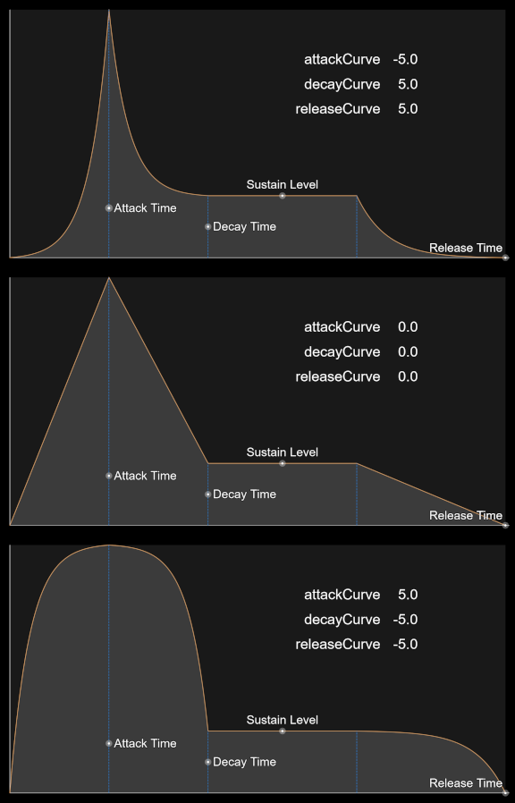](https://www.desmos.com/calculator/xte2latabp)<br>
[*Click here for an interactive Desmos graph.*](https://www.desmos.com/calculator/xte2latabp)


---

<a id="snd"></a>

## The Sound Object

#### `Sound(data = None, channels = None, layered = True)`

|Parameter|Description|
|---:|:---|
|`data`|A list of `Tone` and recipe-control objects, a `Sequence`,  or `None` for an empty sound.|
|`channels`|`1` for mono or `2` for stereo. `None` uses `Sound.CHANNELS` (stereo by default).|
|`layered`|Whether a list of `Tone` and inserted sounds should be interpreted as simultaneous layers or sequential events.<Br>Ignored when a `Sound` is constructed from a `Sequence`.|

The `Sound` object is a container for all rendered sounds. It can be constructed from a `Sequence`, a list of `Tone` objects and control commands, other inserted `Sound` objects or a list of `Sound` objects that are mixed together with `Sound.Mix([sound1, sound2, ...])`.

<a id="snd-create"></a>

### Creating a Sound Effect

Alongside constructing sounds by building sequences and routing them through patches, `Sound` objects can also be built directly from `Tone` objects and other control commands.<br>

While `Tone` commands in a `Patch` recipe are interpreted as simultaneous oscillator events, `Tone` commands and inserted sounds in a `Sound` recipe can be interpreted simultaneously or sequentially by setting `layered` when constructing the `Sound`.

By default, `layered = True` and all `Tone` commands and inserted sounds are interpreted as simultaneous events. If `layered` is set to `False`, that behavior changes and all `Tone` commands and inserted sounds are interpreted as consecutive events in time.

`Tone` durations in `Sound` objects are interpreted as seconds by default, not fractions of whole notes.

Example:

```python
from Chirper import *
import random

def Snd_DealCard(leadup = 0.2):

    return Sound.Mix([

        # TODO:
        # Sound example to be inserted in the future
        # Should demonstrate mixing and building sounds

    ])

class MySounds:
    cards = []

# Create 4 variations using different leadup times
# and store them in a list
for _ in range(4):
    MySounds.cards.append(
        Snd_DealCard(leadup = random.random() * 0.2)
    )
```
<a id="snd-music"></a>

### Getting More Musical

Sequences should be the preferred method for creating music, but the `Sound` object allows some musical directions as well. Commands such as `Tempo` can be inserted to interpret all `Tone` durations as fractions of one whole note, and `Seconds` can be called to switch following `Tone` durations back to seconds. `Sound` recipes do not support `Meter`.

```python
from Chirper import *

def _NewSound():
    return Sound([

            # Interpret following Tone durations as fractions of one whole note:
            Tempo(120),

            # Set default wave for all following tones:
            Wave("TriangleAA"),

            Tone(N.C4, L.L8D, D.D10),
            Tone.Rest(L.L16),
            Tone(N.E4, L.L8D, D.D10),
            Tone.Rest(L.L16),
            Tone(N.G4, L.L8D, D.D10),
            Tone.Rest(L.L16),
            Tone(N.B3, L.L4 , D.D10),

            # Interpret following durations as seconds:
            Seconds(),

            Tone(N.C4, 3.5, D.D10).Wave("Pulse50AA").Vibrato(V.HEAVY, rate = 12.0),

        # Make sure to set layered to False for sequential tones
        ], layered = False)

class MySounds:
    newSound = _NewSound()
```

Other controls available to `Sound` recipes include `Insert`, which we talked about earlier, `Pitch(amount)` which scales all following `Tone` frequency values by `amount`, and commands for setting default values for vibrato/tremolo depth/rate/wave, as well as `Wave`, which sets the default wave used by following `Tone` commands.

<a id="snd-layer"></a>

### Layered vs Sequential Sounds

It's been mentioned before, but it's worth highlighting again; Sound recipes can be interpreted either simultaneously or sequentially. By default, the argument `layered` is set to `True`.

When `layered = False`, tones are not layered and are instead consecutive events in time. Each `Tone` or inserted `Sound` must wait for the previous event to finish before it can start playing.
When `layered = True`, the `Sound` recipe behaves like a `Patch` recipe and all `Tone` commands are interpreted as simultaneous events in time, like layers.

Layered sounds last as long as their longest layer - the longest `Tone` or inserted `Sound` that's present. No gain reduction, clipping or normalization is applied to layered sounds.

> #### **_Note:_** When a `Sound` is built from a `Sequence` instead of a list of `Tone` commands, `layered` is ignored.

```python
from Chirper import *

# TODO:
# Code example of layered vs non layered sound

```

---

<a id="tones"></a>

## Tones - The Building Blocks

#### `Tone(freq = N.C4, duration = 0.25, amplitude = 1.0)`

|Parameter|Description|
|---:|:---|
|`freq`|Frequency in Hz. None produces silence.|
|`duration`|Seconds, or a whole-note fraction while Tempo mode is active.|
|`amplitude`|Non-negative linear sample gain.|

Every `Sound` generated by Chirper is made of `Tone` objects. `Tone` objects describe oscillator events and tell the synthesizer what to render. Chirper outputs Sine waves by default, but that can be overridden with the `Wave(wave)` control command. Wave output can also be overridden on a per `Tone` basis by chaining `.Wave(wave)` to a `Tone` object.

`Tone` objects can be used to construct `Sound` objects directly, or they can be written into a `Patch` recipe, as discussed earlier.

<a id="ton-wave"></a>

### A Note on Waves

Chirper includes all the most basic waveforms as well as a few noise generators.

|Pitched Wave|Description|
|---:|:---|
|`"Sine"`|A sine wave.|
|`"Triangle"`|A triangle wave|
|`"Saw"`|A sawtooth wave|
|`"Pulse50"`|50% duty cycle pulse wave (square wave)|
|`"Pulse25"`|25% duty cycle pulse wave|
|`"Pulse12"`|12.5% duty cycle pulse wave|
|`"TriangleAA"`|An anti-aliased triangle wave|
|`"SawAA"`|An anti-aliased sawtooth wave|
|`"Pulse50AA"`|An anti-aliased 50% duty cycle pulse wave (square wave)|
|`"Pulse25AA"`|An anti-aliased 25% duty cycle pulse wave|
|`"Pulse12AA"`|An anti-aliased 12.5% duty cycle pulse wave|

|Noise Wave|Description|
|---:|:---|
|`"Noise"`|White noise|
|`"NoiseLP"`|Low-passed white noise (note/tone frequency controls the cutoff)|
|`"NoiseHP"`|High-passed white noise (note/tone frequency controls the cutoff)|
|`"NoiseBP"`|Band-passed white noise (note/tone frequency controls the midpoint)|
|`"NoiseStep"`|Sample and hold noise (note/tone frequency controls the clock rate)|
|`"NoiseQuanta"`|Quantized noise (note/tone frequency controls the update rate)|

Rendered `Sound` objects can also be used as waves. Their entire duration will count as one cycle, and `.Phase(degrees)` will simply offset the starting sample point.

<a id="ton-custom"></a>

### Defining a Custom Wave

Custom waves can be defined as Python functions. The function receives the current time and frequency and must return a single floating point sample value.

```python
def CustomWave(time, frequency):
    return sample
```

`time` is the oscillator time in seconds, including any phase offset.<br>
`frequency` is the current oscillator frequency in Hz. This reflects pitch bends and vibrato.

The returned sample should normally be in the range between `-1.0` and `1.0`, but this is not enforced.

For example, this function combines a fundamental sine wave with a quieter second harmonic, which is then passed as a wave to the `Tone` object:

```python
from Chirper import *
import math

def DoubleSine(time, frequency):
    phase = time * frequency * 2.0 * math.pi
    fundamental = math.sin(phase)
    secondHarmonic = math.sin(phase * 2.0) * 0.35
    return (fundamental + secondHarmonic) / 1.35

sound = Sound([
    Tone(N.C4, 1.0, D.D10).Wave(DoubleSine),
])
```

Custom waves support `.Phase()` when their cycle position is derived from `time * frequency`. A function that ignores `time` or `frequency` may not respond to phase or pitch controls as expected.

Custom wave functions can also be passed anywhere else that accepts a wave, including vibrato, tremolo, phase modulation, ring modulation, chorus, autopan and phaser controls.

Chirper does not clip custom carrier waves. Values outside `-1.0` to `1.0` are allowed, but will increase the resulting signal level. Custom Python functions are also slower to render than Chirper's built-in waves because they must be called once for every generated sample.

---

<a id="effects"></a>

## Effects

Special effects can be applied to some objects. `Tone` effects control how waves are synthesized, DSP effects apply to rendered `Sound` objects and `Note` effects control musical articulation.

Most effects can be chained indefinitely. The exceptions are `Chord()` and `Arpeggio()`, which are mutually exclusive, and the two bend modes: `Bend()`/`StepBend()` cannot be combined with `BendIn()`/`BendOut()`. `BendIn()` and `BendOut()` may be used together. When incompatible effects are declared, the last declared mode takes priority.

<a id="fx-tone"></a>

### Tone Effects

`Tone` effects are applied at wave generation.

`Wave(wave)`<br>
`Vibrato(depth = None, rate = None, wave = None)`<br>
`Tremolo(depth = None, rate = None, wave = None)`<br>
`Mod(freq, depth = 1.0, wave = "Sine")`<br>
`Pan(amount)`<br>
`AutoPan(depth = 1.0, rate = 1.0, wave = "Sine", offset = 0.0)`<br>
`Phase(degrees)`<br>
`Bend(target, easing = "linear")`<br>
`BendIn(start, duration, easing = "linear")`<br>
`BendOut(target, duration, easing = "linear")`<br>
`Fade(target, easing = "linear")`<br>
`FadeIn(duration, easing = "linear")`<br>
`FadeOut(duration, easing = "linear")`<br>
`Unison(voices = 3, detune = 10.0, spread = 1.0)`<br>
`Arpeggio(pattern, step = 0.125, dynamics = None, rotation = 0)`<br>

<a id="fx-dsp"></a>

### DSP Effects

DSP effects can be applied to `Sound` objects.

##### Mixing

`Cut(duration, fade = 0.003)`<br>
`Append(sound, crossfade = 0.0, easing = "cosine")`<br>
`FadeIn(duration, easing = "linear")`<br>
`FadeOut(duration, easing = "linear")`<br>
`Reverse()`<br>
`Invert()`<br>
`Gain(amount)`<br>
`Debias()`<br>
`Clip(limit = 1.0)`<br>
`Normalize(headroom = 0.0)`<br>
`Pan(amount)`<br>
`Mono()`<br>
`Stereo()`<br>

##### Filters

`LowPass(freq, q = Q.MID)`<br>
`HighPass(freq, q = Q.MID)`<br>
`BandPass(freq, q = Q.MID)`<br>
`Notch(freq, q = Q.MID)`<br>
`Peak(freq, db, q = Q.MID)`<br>
`LowShelf(freq, db, q = Q.MID)`<br>
`HighShelf(freq, db, q = Q.MID)`<br>
`LowPassSweep(startFreq, endFreq, q = Q.MID, easing = "linear")`<br>
`HighPassSweep(startFreq, endFreq, q = Q.MID, easing = "linear")`<br>
`BandPassSweep(startFreq, endFreq, q = Q.MID, easing = "linear")`<br>
`NotchSweep(startFreq, endFreq, q = Q.MID, easing = "linear")`<br>
`PeakSweep(startFreq, endFreq, db, q = Q.MID, easing = "linear")`<br>
`LowShelfSweep(startFreq, endFreq, db, q = Q.MID, easing = "linear")`<br>
`HighShelfSweep(startFreq, endFreq, db, q = Q.MID, easing = "linear")`<br>

##### Effects

`SoftClip(drive = 2.0, mix = 1.0)`<br>
`Ring(freq, mix = 1.0, wave = "Sine")`<br>
`Chorus(rate = 0.8, depth = 0.003, delay = 0.015, voices = 2, feedback = 0.0, spread = 1.0, mix = 0.5, wave = "Sine")`<br>
`Phaser(rate = 0.5, minFreq = 300.0, maxFreq = 1600.0, stages = 6, feedback = 0.2, spread = 1.0, mix = 0.5, wave = "Sine")`<br>
`AutoPan(depth = 1.0, rate = 1.0, wave = "Sine", offset = 0.0)`<br>

##### Reverb/Delay

`Schroverb(wet = 0.35, decay = 0.72, roomSize = 1.0, tail = None)`<br>
`Freeverb(wet = 0.35, decay = 0.84, damping = 0.5, width = 1.0, tail = None)`<br>
`MTVerb(wet = 0.35, decay = 0.72, mode = "room", tail = None)`<br>
`Delay(delay = 0.25, decay = 0.5, count = None, extend = True)`<br>
`PingPong(delay = 0.25, decay = 0.5, count = None, width = 1.0, extend = True)`<br>

<a id="fx-note"></a>

### Note Effects

Note effects are related to musical articulation.

`Bend(target, easing = "linear")`<br>
`BendIn(start, duration, easing = "linear")`<br>
`BendOut(target, duration, easing = "linear")`<br>
`StepBend(target, ratios = None, easing = "linear")`<br>
`Pan(amount)`<br>
`AutoPan(depth = 1.0, rate = 1.0, wave = "Sine", offset = 0.0)`<br>
`Vibrato(depth = None, rate = None, wave = None)`<br>
`Tremolo(depth = None, rate = None, wave = None)`<br>
`Fade(target, easing = "linear")`<br>
`FadeIn(duration, easing = "linear")`<br>
`FadeOut(duration, easing = "linear")`<br>
`Trill(target, length = L.L32)`<br>
`Chord(pattern, roll = 0.0, dynamics = None, inversion = 0)`<br>
`Arpeggio(pattern, step = L.L16, dynamics = None, rotation = 0)`<br>

---

<a id="easing"></a>

## Easing Functions

Several Chirper functions accept optional easing functions to help shape the sound. Fading, pitch bending and filter sweeping all support easing functions. All functions with easing support use `"linear"` by default.

Easing names are case-insensitive.

Available easing functions are:

|Concave|Convex|S-Shaped|
|:---:|:---:|:---:|
|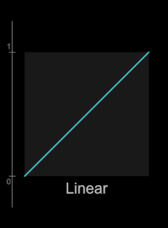<br>`"linear"`|<br>`"linear"`|<br>`"linear"`|
|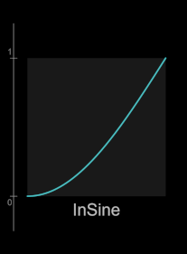<br>`"inSine"`|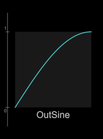<br>`"outSine"`|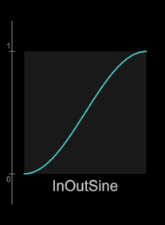<br>`"inOutSine"`|
|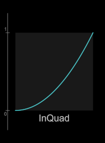<br>`"inQuad"`|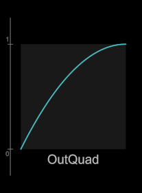<br>`"outQuad"`|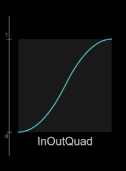<br>`"inOutQuad"`|
|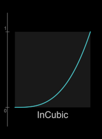<br>`"inCubic"`|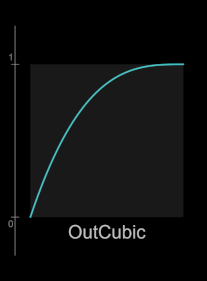<br>`"outCubic"`|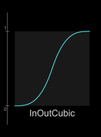<br>`"inOutCubic"`|
|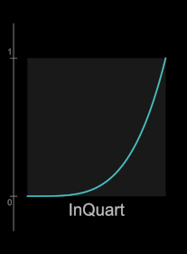<br>`"inQuart"`|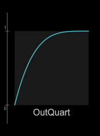<br>`"outQuart"`|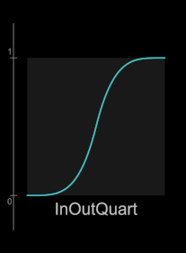<br>`"inOutQuart"`|
|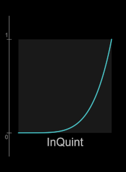<br>`"inQuint"`|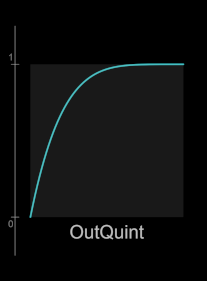<br>`"outQuint"`|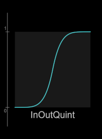<br>`"inOutQuint"`|
|<br>`"inCircle"`|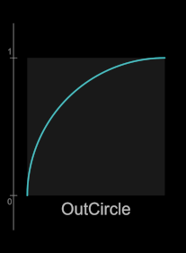<br>`"outCircle"`|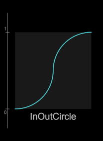<br>`"inOutCircle"`|
|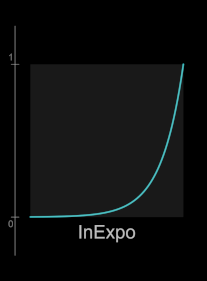<br>`"inExpo"`|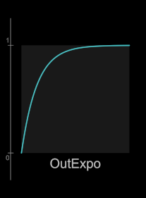<br>`"outExpo"`|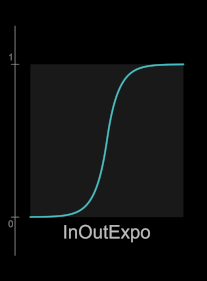<br>`"inOutExpo"`|
|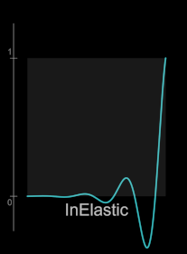<br>`"inElastic"`|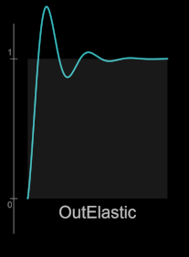<br>`"outElastic"`|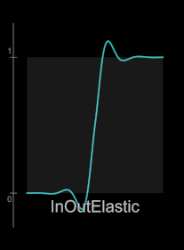<br>`"inOutElastic"`|
|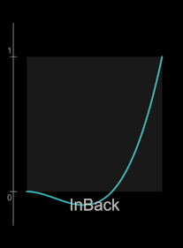<br>`"inBack"`|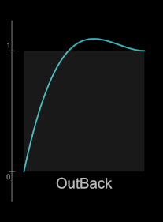<br>`"outBack"`|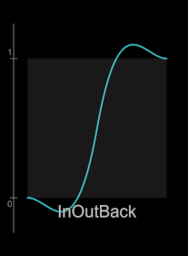<br>`"inOutBack"`|
|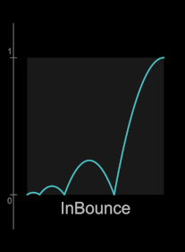<br>`"inBounce"`|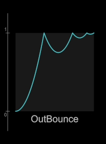<br>`"outBounce"`|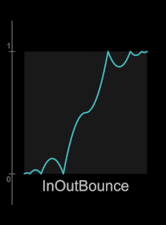<br>`"inOutBounce"`|
|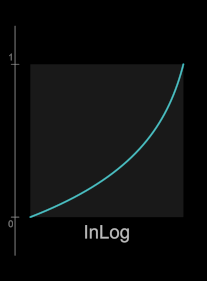<br>`"inLog"`|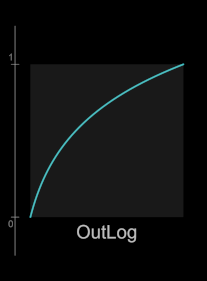<br>`"outLog"`|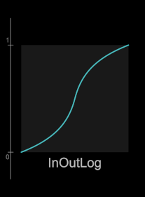<br>`"inOutLog"`|

|3rd Order|5th Order|7th Order|
|:---:|:---:|:---:|
|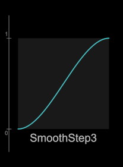<br>`"SmoothStep3"`|<br>`"SmoothStep5"`|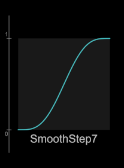<br>`"SmoothStep7"`|

For an interactive animation of the various easing curves, see this [Desmos Graph](https://www.desmos.com/calculator/4pdxufeg0m). Note that some functions may overshoot or undershoot the target before settling.

<a id="eas-custom"></a>

### Custom Easing Functions

Chirper also supports user-defined easing controls if none of the included functions are up to scratch. An easing function takes in a single variable in the range `0.0` to `1.0`, and returns a single value. Returned values are not clamped and may exceed `1.0`.

```python
from Chirper import *

def SmoothStep(t):
    return t * t * (3.0 - (2.0 * t))

sound = Sound([
    Tone(N.C4, 1.0, D.D10).Bend(N.C5, SmoothStep)
])

sound = sound.FadeIn(0.5, SmoothStep)
```

---

<a id="playback"></a>

## Playback

Rendered and loaded `Sound` objects can be played back using `ChirpPlayer`, which is exposed through `Chirper`.

<a id="play-chirp"></a>

### Chirper and ChirpPlayer

`ChirpPlayer` along with `ChirpMixer` and `ChirpOutput` are the modules responsible for playing back sound. They send audio data directly to Windows' buffers and thus only Windows is currently supported for playback.

Both modules are exposed through `Chirper`, which is the public wrapper.

```python
from Chirper import *

# Load "sounds/some_sound.chirp" as a Sound object
sound = Sound.Load("sounds/some_sound")

# Create a player
chirper = Chirper()

# Play the sound back
# blocking = True waits for the sound to finish playing before the script resumes
chirper.Play(sound, blocking = True)

chirper.Close()
```

Available player commands:

<a id="play-play"></a>

#### `Play(sound, volume = 1.0, blocking = False, voice = None)`

|Parameter|Description|
|---:|:---|
|`sound`|`Sound` object to play.|
|`volume`|Playback volume. This is a perceptual volume control, not linear gain. Internally the value is squared.|
|`blocking`|If `True`, the script waits until the `Sound` completes playback before continuing.|
|`voice`|Explicitly select a voice for playback. Chirper will auto-assign voices, so you will likely not need to use this.|

<a id="play-solo"></a>

#### `PlaySolo(sound, volume = 1.0, blocking = False)`

Stops all active and queued voices and sounds, and plays the requested `Sound`.

<a id="play-queued"></a>

#### `PlayQueued(sound, volume = 1.0, voice = None)`

Queues up a `Sound` on a specified voice.

<a id="play-stopall"></a>

#### `StopAll()`

Stops all active and queued voices and sounds.

<a id="play-vol"></a>

#### `SetVolume(volume)`

Sets the perceptual master playback volume for future `Sound` playback.

<a id="play-stats"></a>

#### `GetStats()`

Returns statistics from the player, such as active voice count, buffer size, blocks rendered, batched refills, maximum block-render time and block durations. Mostly useful for debugging.

<a id="play-handle"></a>

### Voice Handle

Playing a sound returns a handle, which can be used to query and control the playing sound.

```python
from Chirper import *

# Load "sounds/some_sound.chirp" as a Sound object
sound = Sound.Load("sounds/some_sound")

chirper = Chirper()

# Start non-blocking playback (blocking = False by default)
soundHandle = chirper.Play(sound)

# Check whether the sound is still playing
if soundHandle.IsPlaying():

    # Wait until the sound finishes,
    # or 1 second passes
    soundHandle.Wait(1.0)

    # Stop the sound if it's still playing
    soundHandle.Stop()

chirper.Close()
```

For most situations where you want the script to wait until playback is finished, you'll probably want to use `blocking = True` when calling `Play` on a `Sound`. If, however, you need to start playback asynchronously, perform other work, then decide later which specific sound to wait for, you may want to call `Wait(timeout)` on its voice handle instead. Passing `None` or nothing to `Wait` waits until the entire `Sound` has finished playing.

---

<a id="saveload"></a>

## Saving and Loading Sounds

Once you have constructed a `Sound` from a `Sequence` or a `Tone` recipe, you may want to save the rendered sound for future playback and posterity. You may also want to load in a previously rendered sound, or load in a sample from somewhere else to use in future sounds or playback.

<a id="sl-save"></a>

### Saving Sounds

By default, Chirper writes sounds to its native `.chirp` file format; however Chirper can also read and write `.wav` files. Once a sound is constructed, simply call `Sound.Save(path)` to save a `Sound`. You do not need to supply a file extension, Chirper will resolve missing extensions automatically. The `Save` function returns the saved filepath if successful.

To save out a `.wav` file, use the function `Sound.SaveWav(path)`. Note that exporting to `.wav` will clip values outside the range -1 to +1. `.chirp` files store floating point samples and do not clip.

```python
from Chirper import *

beep = Sound([Tone(1000.0, 0.25, 0.8)])

chirpPath = beep.Save("sounds/beep")
print(f"Chirp file was saved to {chirpPath}")

wavPath = beep.SaveWav("sounds/beep")
print(f"Wave file was saved to {wavPath}")
```

<a id="sl-load"></a>

### Loading Sounds

Loading works in pretty much the same way as saving files. The only difference is that `Load` returns a `Sound` object, not the filepath.
Supported wave files are mono or stereo 44.1kHz PCM, either 8, 16 or 24bit integer.

```python
from Chirper import *

# Load "sounds/beep.chirp" as a Sound object
beepFromChirp = Sound.Load("sounds/beep")

# Load "sounds/beep.wav" as a Sound object
beepFromWav = Sound.LoadWav("sounds/beep")

# Play the sounds back
chirper = Chirper()

chirper.Play(beepFromChirp, blocking = True)
chirper.Play(beepFromWav,   blocking = True)

chirper.Close()
```

---

<a id="constants"></a>

## Constants

Chirper contains a few constant classes to make inputting sounds easier.

<a id="con-freq"></a>

### Note Frequency

Equal-tempered note frequencies from C1 through B9. Middle C is C4.<br>
`N.MIN` and `N.MAX` represent the approximate lower and upper limits of human hearing.

`N` is a shortened alias for `NoteFrequency`.

```python
class NoteFrequency:
    MIN         = 20.0
    MAX         = 20000.0

    C1          = 32.70
    CS1         = 34.65

    ...
    ...
    ...

    C4          = 261.63
    CS4         = 277.18
    DB4         = 277.18
    D4          = 293.66
    DS4         = 311.13
    EB4         = 311.13
    E4          = 329.63
    F4          = 349.23
    FS4         = 369.99
    GB4         = 369.99
    G4          = 392.00
    GS4         = 415.30
    AB4         = 415.30
    A4          = 440.00
    AS4         = 466.16
    BB4         = 466.16
    B4          = 493.88

    ...
    ...
    ...

    B9          = 15804.27
N = NoteFrequency
```

> #### **_Note_**: Values are shown rounded to the nearest two decimal places. Chirper calculates frequencies at a much higher precision internally.

<a id="con-len"></a>

### Note Length

`Note` durations are fractions of one whole note in a `Sequence`, and `Tone` durations are fractions of one whole note when `Tempo` is active. To make entering durations easier, you can use the `NoteLength` class.

`L` is a shortened alias for `NoteLength`.

```python
class NoteLength:

    # Regular notes
    L8X   = 8.0                 # 8 whole notes
    L4X   = 4.0                 # 4 whole notes
    L2X   = 2.0                 # 2 whole notes
    L1    = 1.0                 # Whole note
    L2    = 1.0 / 2.0           # Half note
    L4    = 1.0 / 4.0           # Quarter note
    L8    = 1.0 / 8.0           # Eighth note
    L16   = 1.0 / 16.0          # Sixteenth note
    L32   = 1.0 / 32.0          # Thirty-second note
    L64   = 1.0 / 64.0          # Sixty-fourth note

    # Dotted notes
    L1D  = 3.0 / 2.0            # Dotted whole note
    L2D  = 3.0 / 4.0            # Dotted half note
    L4D  = 3.0 / 8.0            # Dotted quarter note
    L8D  = 3.0 / 16.0           # Dotted 8th note
    L16D = 3.0 / 32.0           # Dotted 16th note
    L32D = 3.0 / 64.0           # Dotted 32nd note
    L64D = 3.0 / 128.0          # Dotted 64th note

    # Triplets
    L1T  = L1  * (2.0 / 3.0)    # whole note triplet
    L2T  = L2  * (2.0 / 3.0)    # half note triplet
    L4T  = L4  * (2.0 / 3.0)    # quarter note triplet
    L8T  = L8  * (2.0 / 3.0)    # 8th note triplet
    L16T = L16 * (2.0 / 3.0)    # 16th note triplet
    L32T = L32 * (2.0 / 3.0)    # 32nd note triplet
    L64T = L64 * (2.0 / 3.0)    # 64th note triplet
L = NoteLength
```

Traditional and descriptive names are also aliases for these values, so `L.QUAVER`, `L.CROTCHET` as well as `L.QUARTER`, `L.EIGHTDOT` will work.

<a id="con-dyn"></a>

### Note/Tone Dynamics

`Note` and `Tone` amplitudes are linear gain values. To help them feel more perceptual, the `Dynamics` class contains 16 steps of perceptually spaced linear gain values.

`D` is a shortened alias for `Dynamics`.

```python
class Dynamics:
    D00     = 0.0000000
    D01     = 0.0078125
    D02     = 0.0110485
    D03     = 0.0156250
    D04     = 0.0220971
    D05     = 0.0312500
    D06     = 0.0441942
    D07     = 0.0625000
    D08     = 0.0883883
    D09     = 0.1250000
    D10     = 0.1767767
    D11     = 0.2500000
    D12     = 0.3535534
    D13     = 0.5000000
    D14     = 0.7071068
    D15     = 1.0000000
D = Dynamics
```
<a id="con-vib"></a>

### Vibrato Strength

Instead of entering pitch depth for vibrato numerically, use the `Vibrato` class.

`V` is a shortened alias for `Vibrato`.

```python
class Vibrato:
    NONE    = 0.0
    XLIGHT  = 12.5
    LIGHT   = 25.0
    MEDIUM  = 50.0
    HEAVY   = 75.0
    XHEAVY  = 100.0
V = Vibrato
```

<a id="con-trem"></a>

### Tremolo Strength

Instead of entering modulation depth for tremolo numerically, use the `Tremolo` class.

`T` is a shortened alias for `Tremolo`.

```python
class Tremolo:
    NONE    = 0.0
    XLIGHT  = 0.125
    LIGHT   = 0.25
    MEDIUM  = 0.5
    HEAVY   = 0.75
    XHEAVY  = 1.0
T = Tremolo
```

<a id="con-q"></a>

### Filter QFactor

`QFactor` provides common settings for filter resonance.

`Q` is a shortened alias for `QFactor`.

```python
class QFactor:
    BROAD   = 0.25
    WIDE    = 0.5
    MID     = 0.707
    NARROW  = 1.0
    TIGHT   = 2.0
Q = QFactor
```

<a id="con-ratio"></a>

### Frequency Ratios

The `JustRatio` class contains just intonation frequency intervals and the `EqualRatio` class contains equal-temperament frequency intervals. These are useful for `Note` articulations with `Chord`, `Arpeggio`, `Trill`, and `Bend`/`StepBend`.

`JR` is a shortened alias for `JustRatio`.<br>
`ER` is a shortened alias for `EqualRatio`.

```python
# Just intonation ratios
class JustRatio:
    UNISON          =  1.0
    UNI             =  UNISON
    MIN2            = 16.0 / 15.0
    MAJ2            =  9.0 /  8.0
    MIN3            =  6.0 /  5.0
    MAJ3            =  5.0 /  4.0
    FOURTH          =  4.0 /  3.0
    AUG4            = 45.0 / 32.0
    DIM5            = 64.0 / 45.0
    FIFTH           =  3.0 /  2.0
    MIN6            =  8.0 /  5.0
    MAJ6            =  5.0 /  3.0
    MIN7            =  9.0 /  5.0
    MAJ7            = 15.0 /  8.0
    OCTAVE          =  2.0
    OCT             =  OCTAVE
JR = JustRatio
```
```python
# Equal temperament ratios
class EqualRatio:
    UNISON          = 2.0 ** (0.0 / 12.0)
    UNI             = UNISON

    MIN2            = 2.0 ** (1.0 / 12.0)
    MAJ2            = 2.0 ** (2.0 / 12.0)
    MIN3            = 2.0 ** (3.0 / 12.0)
    MAJ3            = 2.0 ** (4.0 / 12.0)
    FOURTH          = 2.0 ** (5.0 / 12.0)
    AUG4            = 2.0 ** (6.0 / 12.0)
    DIM5            = AUG4
    FIFTH           = 2.0 ** (7.0 / 12.0)
    MIN6            = 2.0 ** (8.0 / 12.0)
    MAJ6            = 2.0 ** (9.0 / 12.0)
    MIN7            = 2.0 ** (10.0 / 12.0)
    MAJ7            = 2.0 ** (11.0 / 12.0)

    OCTAVE          = 2.0 ** (12.0 / 12.0)
    OCT             = OCTAVE
ER = EqualRatio
```

<a id="con-scale"></a>

### Scales and Chords

Common scales, modes and chords are available in the `JustScale` and `EqualScale` classes. Each scale and chord is a list of frequency ratios in just intonation and equal temperament, with root being a ratio of `1.0` and an octave being a ratio of `2.0` in both. These constants are useful for the `StepBend`, `Chord` and `Arpeggio` functions, which each can take in a list of frequency ratios.

`JS` is a shortened alias for `JustScale`.<br>
`ES` is a shortened alias for `EqualScale`.

```python
# Equal temperament
class EqualScale:

    # Scales
    CHROMATIC
    WHOLE_TONE
    MAJOR
    MINOR
    HALF_WHOLE
    WHOLE_HALF
    DIMINISHED      # Alias for WHOLE_HALF
    DOM_DIM         # Alias for HALF_WHOLE
    HARM_MAJ        # Harmonic major
    MELO_MIN        # Melodic minor
    HARM_MIN        # Harmonic minor
    PENTA_MIN       # Pentatonic minor
    PENTA           # Alias for PENTA_MIN
    PENTA_MAJ       # Pentatonic major
    PENTA_NEUT      # Neutral pentatonic
    PENTA_BLUES     # Pentatonic minor with added diminished fifth
    BLUES           # Alias for PENTA_BLUES

    # Modes
    IONIAN          # Alias for MAJOR
    DORIAN
    PHRYGIAN
    LYDIAN
    MIXOLYDIAN
    AEOLIAN         # Alias for MINOR
    LOCRIAN
    LYDIAN_DOM      # Lydian dominant

    # Chords
    MAJ
    MIN
    SUS2
    SUS4
    DIM
    AUG
    FOURTH
    FIFTH
    POWER           # 5th chord with octave
    MIN6
    MAJ6
    SIXTH           # Alias for MAJ6
    MAJ7
    MIN7
    DOM7
    SEVENTH         # Alias for DOM7
    DIM7
    HALFDIM7
    MIN7B5          # Alias for HALFDIM7
    MINMAJ7
    MAJMIN7         # Alias for DOM7
    AUG7
    AUGMAJ7
    ADD9
    MAJADD9         # Alias for ADD9
    MINADD9
    MINMAJ9
    MAJ9
    MIN9
    DOM9
    MAJMIN9         # Alias for DOM9
    SUS7
    SUS9

ES = EqualScale
```
Just intonation member names are identical to equal temperament member names.
```python
# Just intonation
class JustScale:

    ...
    ...
    # Member names are identical to EqualScale
    ...
    ...

JS = JustScale
```
